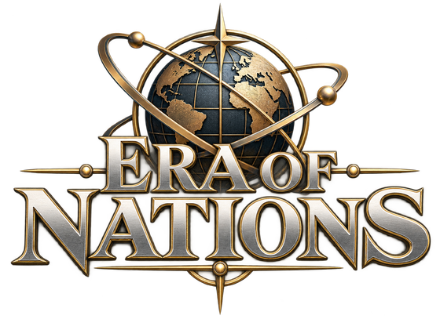

# Era of Nations

A standalone modern era development fork for Hearts of Iron IV 1.19.x. Current work extends diplomacy, economic agreements, resource accounting and missile systems from the inherited gameplay base. The validation status below records what has been checked in source and in the game.

Development repository: [Sany0ssse/Era-of-Nations](https://github.com/Sany0ssse/Era-of-Nations).

- [Local setup](docs/development/SETUP.md)
- [Source and attribution](docs/development/SOURCE.md)
- [Current validation status](docs/development/STATUS.md)
- [Missiles and nuclear arsenal maintenance](docs/development/MISSILE_SYSTEM_UK.md)
- [Contributing](CONTRIBUTING.md)
- [Inherited authors and asset credits](docs/misc/authors.md)

Enable Era of Nations by itself in a dedicated launcher playset. The [Steam Workshop playtest](https://steamcommunity.com/sharedfiles/filedetails/?id=3814861738) provides a separate multiplayer demo. Enable only one copy of the mod, and compare the game version and main-menu checksum before joining friends.

Voluntary support: [Monobank donation jar](https://send.monobank.ua/jar/6TBAbiNNan), [Monobank QR](https://send.monobank.ua/widget.html?jar=5j55h27mgVWM95aXWtooM7Q2VBwnmSAQ&sendId=6TBAbiNNan&type=qr), or [Ko-fi creator page](https://ko-fi.com/mrsan1n1). The mod is free; contributions do not unlock gameplay features.
